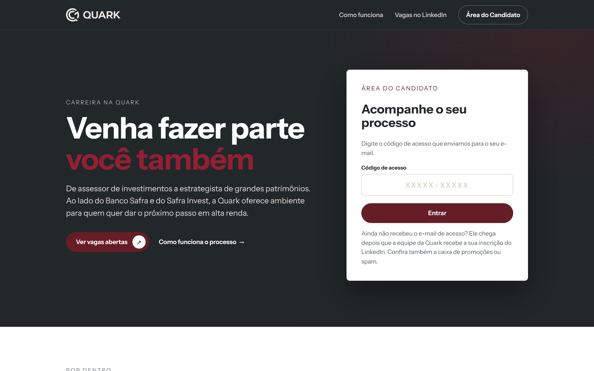
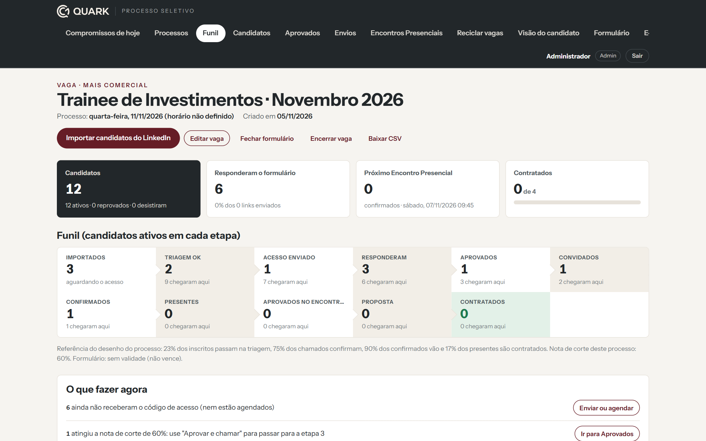
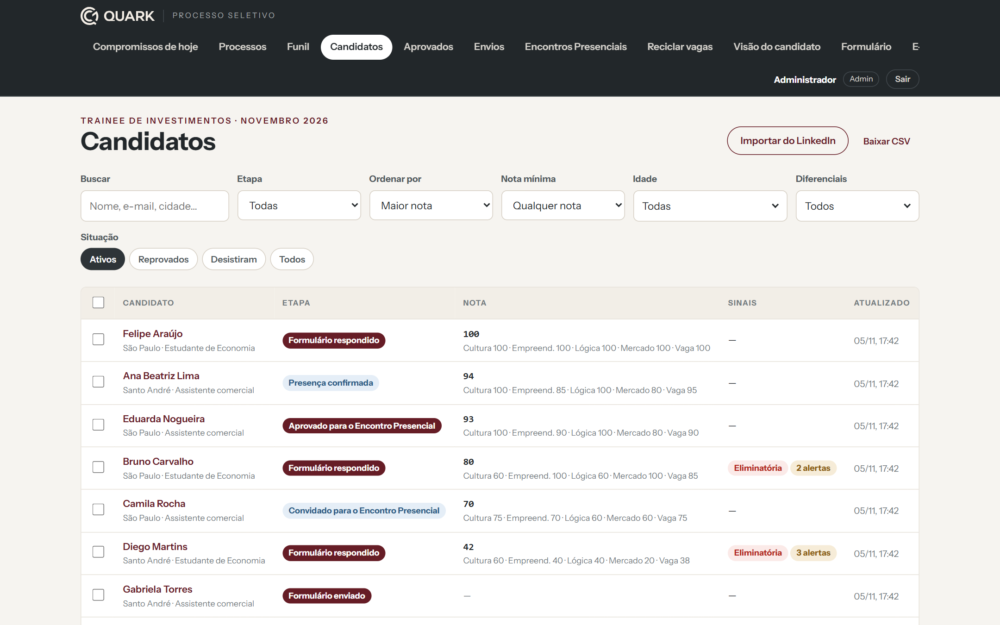
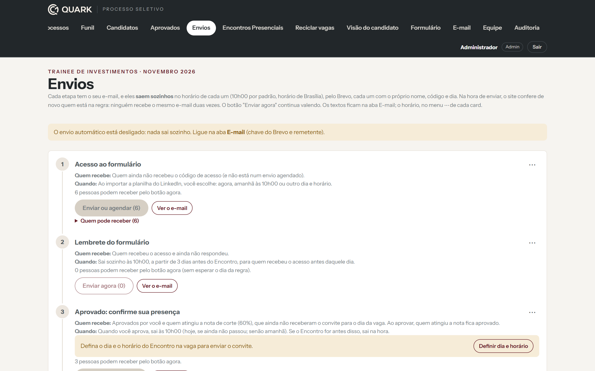
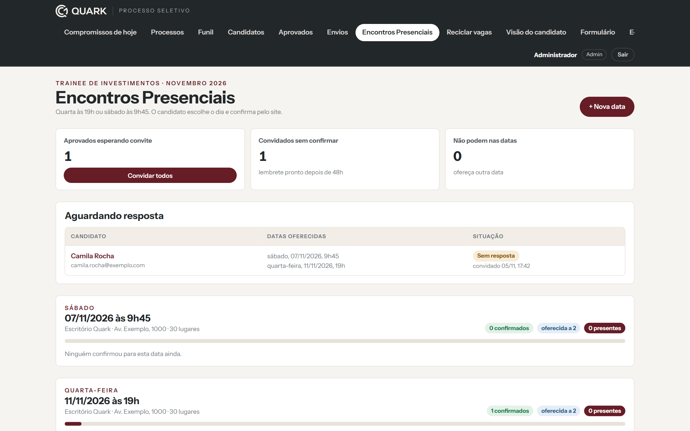
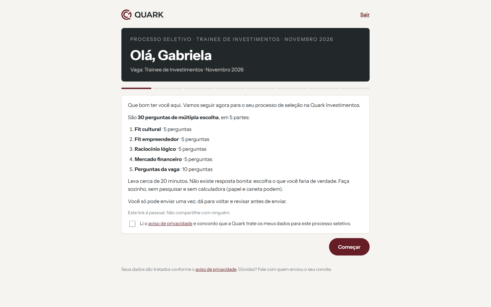
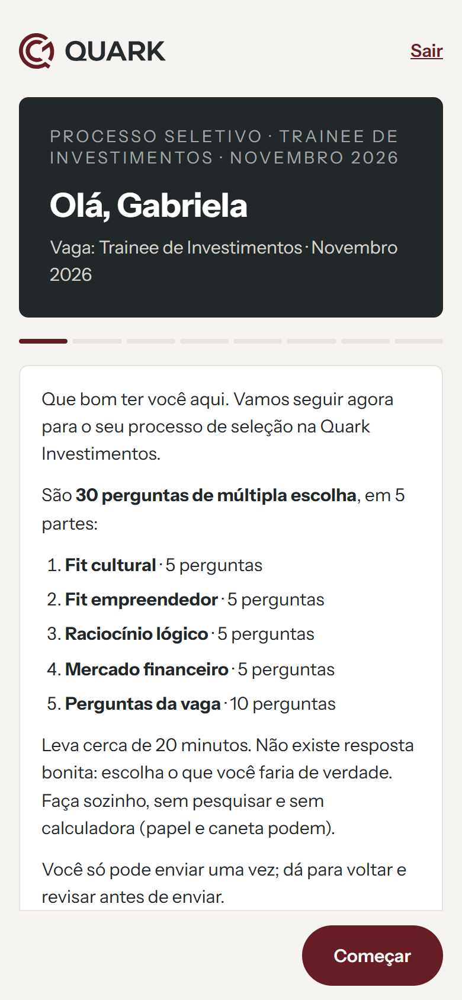
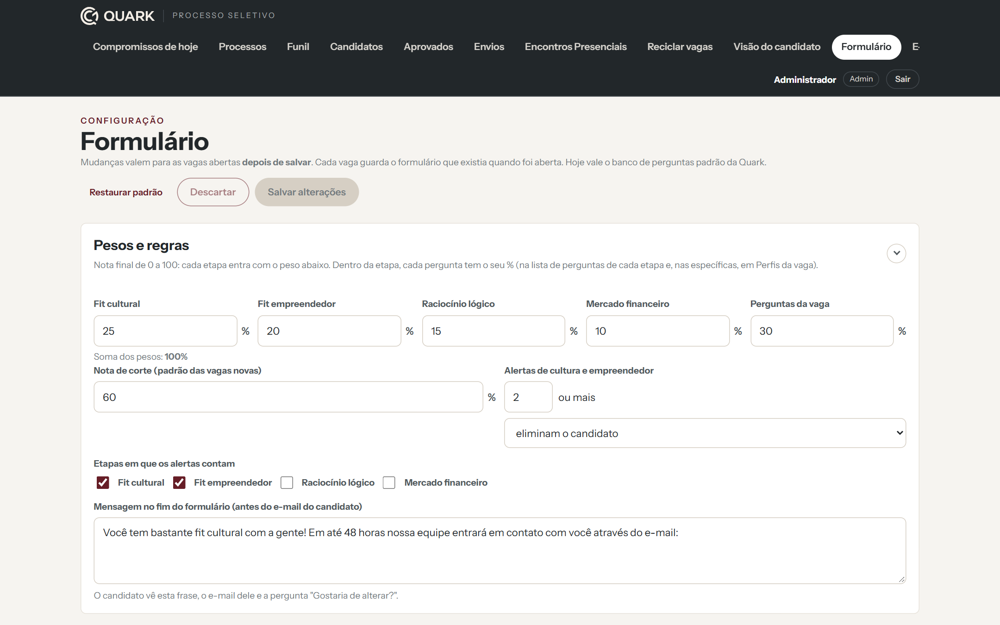

# QuarkRH · Sistema de processo seletivo

Sistema web que desenvolvi para a **Quark Investimentos** organizar os processos seletivos de trainees e assessores, da inscrição no LinkedIn até a contratação. Está em uso desde outubro de 2026 em [quarkrh.com](https://quarkrh.com).

> O código-fonte é da Quark e fica em um repositório privado. Esta página apresenta o projeto, e as imagens foram geradas com **dados fictícios**.

## O problema

A Quark recebe centenas de inscrições por vaga no LinkedIn. Antes, a triagem era manual: planilhas, e-mails um a um e nenhuma forma padronizada de comparar candidatos.

## O que o sistema faz

**Para o candidato**
- Entra com um código de acesso pessoal, sem precisar criar conta.
- Confirma os dados que vieram do LinkedIn ("Você ainda trabalha na Empresa X?") em vez de digitar tudo de novo.
- Responde 30 perguntas de múltipla escolha: fit cultural, fit empreendedor, raciocínio lógico, mercado financeiro e perguntas específicas da vaga.
- Acompanha o processo pelo site e escolhe o dia do Encontro Presencial.

**Para a equipe de RH**
- Abre uma vaga em 5 passos. O sistema monta o formulário pelo perfil da vaga (comercial, equilibrado ou analítico), com pesos e nota de corte ajustáveis.
- Importa o relatório de candidaturas do LinkedIn (.xlsx).
- Vê a nota de cada candidato (0 a 100), com alertas de comportamento e um funil por etapa.
- Envia e-mails automáticos em cada etapa: acesso, lembrete, aprovação e confirmação de presença.
- Envia lembretes por WhatsApp com botões de resposta ("Confirmo presença" ou "Não consigo ir"), e as respostas atualizam o candidato no sistema.
- Organiza os Encontros Presenciais: datas, vagas, confirmações, presença e avaliação de cada candidato por vários avaliadores.

## Telas

| Funil da vaga | Candidatos com nota e alertas |
|---|---|
|  |  |

| Envios automáticos por etapa | Encontros Presenciais |
|---|---|
|  |  |

| Formulário do candidato | No celular | Configuração do formulário |
|---|---|---|
|  |  |  |

## Tecnologias

| Parte | Como foi feita |
|---|---|
| Site e painel | HTML, CSS e JavaScript (módulos ES, sem framework), hospedados na Hostinger |
| Backend | Supabase: banco Postgres, login da equipe (Auth), regras de acesso (RLS) e uma Edge Function |
| E-mail | API do Brevo, com domínio próprio autenticado |
| WhatsApp | API da Zenvia (WhatsApp Business), com modelos aprovados pela Meta e webhook para receber as respostas |
| Publicação | GitHub Actions: site e API publicados a cada atualização |
| Testes | Testes automatizados com o test runner do Node, inclusive num Postgres em memória (PGlite), e testes de tela com Playwright |

## Segurança e LGPD

- O candidato entra só com o código de acesso. O sistema guarda apenas o hash do código.
- Toda alteração passa pelo servidor, que valida os dados e registra quem fez o quê numa auditoria.
- O navegador só lê o que a tela precisa, controlado pelas regras de acesso do banco.
- O site usa cabeçalhos de segurança (CSP e HSTS).
- Aviso de privacidade revisado pelo jurídico, consentimento explícito do candidato e limpeza automática de dados antigos.

## Como foi feito

Conduzi o projeto de ponta a ponta: levantamento com o RH, desenho do processo, regras de pontuação, telas, integrações e publicação. O código foi desenvolvido com o apoio do **Claude Code**, um assistente de programação com IA.
